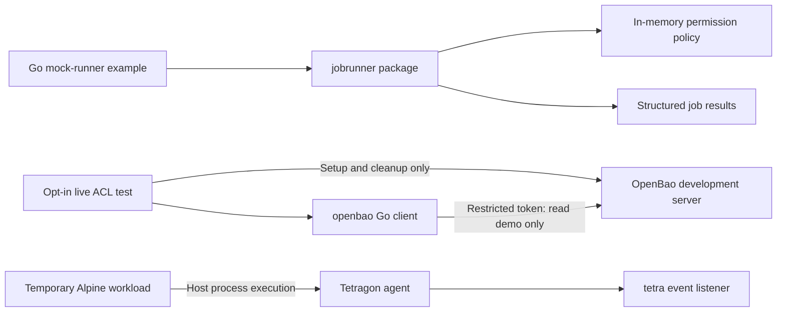

# RunawayBao

**Jobs run. Secrets shouldn't.**

RunawayBao is a development security lab exploring how jobs can access narrowly
scoped secrets while their runtime behavior remains observable. It currently
provides three independently tested components: a mock Go job runner, a fixed-path
OpenBao client, and a Docker Compose lab with OpenBao and Tetragon.

The goal is to connect authorization, secret access, runtime observation, and
audit records incrementally. Those components are **not yet an integrated job
execution system**.

## Current architecture



The runner does not call OpenBao, launch workloads, or consume Tetragon events.
The ACL test supplies the restricted client token; the lab's root token is used
only by its setup/cleanup code and the manual development secret scripts.

## Stack and completed milestones

| Component | Version / implementation |
|---|---|
| Go | 1.22 or newer; standard library only |
| Docker Compose | Plugin v2 or newer |
| OpenBao | `openbao/openbao:2.7.1`, KV v2, development mode |
| Tetragon | `quay.io/cilium/tetragon:v1.7.0`, privileged host observation |
| Test workload | `alpine:3.22` |

| Milestone | Completed behavior |
|---|---|
| 1 | Project-scoped lifecycle scripts, OpenBao health and dummy-secret checks, Tetragon process observation |
| 2 | Deterministic mock job runner, structured results, unit tests |
| 2.1 | Internal action permissions, authorization ordering, concurrency-safe duplicate detection |
| 3.1 | Standalone Go client for the fixed OpenBao demo path |
| 3.2 | Live restricted-token read, independent OpenBao ACL denials, token revocation and fixture cleanup |

Milestone 1 was verified on Docker Desktop with Ubuntu/WSL2 and Linux
6.6.87.2. The live ACL test also passed on that development host. Fresh-clone
reproducibility on another host has not been verified.

## Installation

For the Go examples and offline tests, install Go 1.22 or newer. No Docker,
OpenBao, `.env`, or third-party Go modules are required for those tests.

For the live lab, also provide:

- Docker Engine or Docker Desktop, with the Compose plugin. `docker info` must
  succeed as your user; Docker daemon access grants extensive host privileges.
- Bash, `curl`, and standard Linux utilities including `grep` and `sleep`.
- A compatible Linux Docker host with eBPF/BTF support and accessible
  `/sys/kernel`, `/sys/fs/bpf`, and `/var/run` mounts. Tetragon uses privileged
  mode and host PID/cgroup namespaces.

On Docker Desktop, observation concerns the Linux VM's kernel and processes,
not processes outside that VM. Other kernels and backends require validation.

```bash
git clone https://github.com/grdamico/runawaybao.git
cd runawaybao
```

## Docker Compose lab

Create trusted local configuration; never use real credentials:

```bash
cp .env.example .env
chmod 600 .env
./scripts/start.sh
./scripts/status.sh
```

`.env.example` contains a development-only placeholder. `BAO_TOKEN` configures
the development root token; `BAO_PORT` defaults to 8200. Choose an unused port
such as 18200 if needed. The API binds only to `127.0.0.1`. `.env` is ignored by
Git and must never be force-added. The shell scripts source it as trusted code.

Scripts explicitly select project `runawaybao` and this repository's Compose
file. Reserve that project name for one lab; multiple clones share it. Startup
polls readiness up to 30 times. Status returns nonzero for unavailable or unhealthy
services and probes the project's containers rather than an unrelated listener.

### Manual dummy-secret checks

```bash
./scripts/put-demo-secret.sh
./scripts/read-demo-secret.sh
```

These development scripts use the setup/root token to write and read the fixed
fake fixture at `secret/demo`. The read script prints the dummy response: never
replace its fixture with real secrets. The Go application client instead requires
a restricted token, as described below.

### Tetragon process observation

In one terminal:

```bash
./scripts/test-process.sh
```

In another:

```bash
docker run --rm --name runawaybao-observation alpine:3.22 sh -c 'sleep 10'
```

Keep the listener running for at least 40 seconds after launching the workload;
event delivery was delayed on the verified host. Look for the corresponding
shell/sleep events, then press `Ctrl+C`. The listener disables Compose stdin
attachment so `tetra` connects to the agent instead of reading JSON from stdin.
Tetragon can observe other host workloads; Compose isolation does not isolate
kernel instrumentation or make the displayed events an audit trail.

### Shutdown and restart

```bash
./scripts/stop.sh
./scripts/start.sh
./scripts/status.sh
```

Shutdown removes this project's containers and network without deleting volumes.
**OpenBao development storage is in memory: stopping its process loses secrets,
policies, and issued tokens.** Recreate the dummy secret after restart. Successful
restart does not demonstrate secret persistence.

### Troubleshooting

- **Port conflict:** change `BAO_PORT` in `.env`; do not stop unrelated containers.
- **Docker permission denied:** check daemon access and Docker Desktop WSL
  integration before running the scripts.
- **Readiness failure:** inspect `docker compose -p runawaybao logs tetragon`
  and, privately, `docker compose -p runawaybao logs openbao`. OpenBao logs can
  disclose the development root token; never publish them unredacted.
- **Another Tetragon instance:** a PID-file guard may prevent startup. Use a
  dedicated host or coordinate an owner-approved shutdown of that instance.
  Never delete or bypass a live PID file.
- **Missing events:** verify kernel/BTF compatibility and Docker-host mounts,
  use the provided listener, and allow the delivery delay. A healthy API or
  running container alone does not prove process observation works.

## Mock job runner

```bash
go run ./cmd/mock-runner
```

The example prints JSON results for success, denial, simulated failure, and an
unknown action. Inspect each result's status; the program's exit code concerns
writing the example output.

Import `github.com/grdamico/runawaybao/jobrunner`:

```go
runner := jobrunner.NewRunner(jobrunner.NewPolicy(jobrunner.PermissionExecute))
result := runner.Run(jobrunner.Job{ID: "example-1", Action: "succeed"})
```

Jobs contain only `ID` and `Action`. Internal metadata requires `mock:execute`
for both `succeed` and `fail`. Unknown actions fail before authorization; missing
grants produce `denied`. Results contain `job_id`, `status` (`succeeded`, `failed`,
or `denied`), and an optional error string suitable for future audit logging.

IDs and actions are exact, case-sensitive strings and cannot be blank.
Structurally invalid requests do not consume IDs. Every valid submission consumes
its ID, including unknown actions, denials, successes, and simulated failures.
Reusing an ID returns a duplicate error. A single mutex serializes submissions
and prevents concurrent duplicate execution. ID history is in-memory and grows
for each runner's lifetime; do not copy a runner.

Policies come from trusted application code. There is no authentication layer.
Standard JSON decoding ignores unknown request fields; such fields cannot
change internal action permissions. No mock action starts a process or reads a
secret.

## OpenBao Go client

Import `github.com/grdamico/runawaybao/openbao` and supply configuration explicitly:

```go
client, err := openbao.NewClient(openbao.Config{
    Address: address,
    Token: restrictedToken,
})
if err != nil {
    return err
}
secret, err := client.ReadDemo(ctx)
// Handle err and use secret in memory; never print or log either credential.
```

The client reads only `/v1/secret/data/demo`, parsing nonempty `username` and
`password` strings from KV v2's `data.data`. It does not load `.env`, provision
tokens, or fall back to root. Supply a token restricted to read-only access on
that path, not the lab's `BAO_TOKEN`.

Requests have a five-second default timeout, configurable via `Config.Timeout`,
and honor context cancellation. Redirects are rejected and responses are limited
to 64 KiB. Configuration accepts an HTTP(S) origin without userinfo, base paths,
queries, or fragments. Use HTTP only on trusted local development loopback;
use HTTPS over untrusted networks.

Errors exclude tokens, secret contents, URLs, response bodies, and transport
diagnostics. Use `errors.Is` with `ErrConfiguration`, `ErrPermissionDenied`,
`ErrNotFound`, `ErrHTTP`, `ErrRequest`, `ErrTimeout`, or `ErrResponse`. Caller
cancellation/deadlines return the context error. Never log configuration or
returned secret structs. The client cannot infer an opaque token's ACLs.

## Tests

Offline tests use the standard `testing` package and `httptest.Server`:

```bash
go test ./...
go test -race ./...
go vet ./...
go vet -tags=integration ./...
```

They cover runner outcomes, ID consumption and concurrency, policy decisions,
JSON results, HTTP authentication, KV v2 parsing, errors, timeouts, cancellation,
and redirect handling. Local loopback sockets are needed for `httptest`.

### Live OpenBao ACL test

With the development lab running and `.env` configured:

```bash
./scripts/test-openbao-acl.sh
```

This opt-in suite uses root only for setup, inspection, and cleanup. It creates
a uniquely named policy containing exactly:

```hcl
path "secret/data/demo" {
  capabilities = ["read"]
}
```

It issues a nonrenewable, five-minute token with `no_default_policy=true`, checks
that its effective policies exclude `default`, `root`, and identity policies,
and supplies only that restricted token to the Go client. Credentials stay in
process memory/environment and are never written to tracked files or printed.

The suite verifies an authorized read, HTTP 403 for updating the demo, and HTTP
403 for reading another existing dummy path. It revokes the issued token,
checks rejection afterward, and removes its unique policy and fixtures. Existing
demo data is preserved and must match the known dummy fixture; an absent demo
is created only if metadata is also absent, and removed during cleanup.

The equivalent invocation, after supplying setup values privately, is:

```bash
# Set RUNAWAYBAO_ACL_ADDR and RUNAWAYBAO_ACL_ROOT_TOKEN privately first.
RUNAWAYBAO_ACL_INTEGRATION=1 go test -tags=integration ./openbao \
  -run '^TestLiveACL$' -count=1 -v
```

The test is excluded without the build tag and skips without explicit opt-in.
Run only against disposable loopback development OpenBao, never production.
Do not enable shell tracing or run concurrent live tests against one server.
Cleanup failures fail the suite; forced termination or connectivity loss may
leave fixtures/policies behind. The token TTL limits credential lifetime if
revocation cannot finish. See [OpenBao token creation](https://openbao.org/docs/commands/token/create/)
and [ACL policies](https://openbao.org/docs/concepts/policies/).

## Security and limitations

- **Development only:** OpenBao dev mode, a known placeholder root token, and
  privileged Tetragon are unsuitable for production. Use dummy data only.
- **Independent enforcement:** application policy checks do not replace OpenBao
  ACLs. The live suite verifies a small ACL matrix, not complete security.
- **No integrated execution:** the runner, secret client, and observer remain
  separate. There is no real job execution, event correlation, persistent audit
  sink, persistent duplicate store, or enforcement response.
- **Credential handling:** keep `.env` private and never publish tokens, secret
  values, or unredacted logs. Go strings cannot be reliably erased from memory.
- **Client scope:** no retries, renewal, caching, or general secret-path API.
- **Host assumptions:** kernel capabilities and mount behavior vary. A pass on
  the verified WSL2 host does not establish portability to another host.

## Roadmap

1. Connect an authorized runner action to the restricted OpenBao client.
2. Add workload identity and carefully scoped real execution.
3. Correlate Tetragon events with individual jobs.
4. Persist audit records for authorization, secret access, and execution outcomes.
5. Explore deterministic policy tests and scoped responses to violations.

## License

[MIT](LICENSE)
