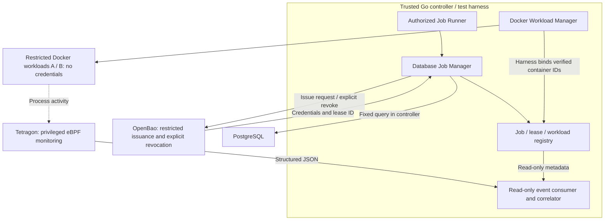

# RunawayBao

**Link temporary credentials to workload identity and runtime activity.**

RunawayBao is an experimental Go security prototype combining OpenBao, PostgreSQL,
Docker, and Tetragon's eBPF observability. It demonstrates per-job database
credentials, selective lease revocation, and read-only runtime event correlation.

Secrets management controls access; runtime monitoring observes behavior. Connecting
them safely requires knowing **which workload owns which credential lease**. An
incorrect attribution could revoke an unrelated job's access. RunawayBao establishes
that mapping before introducing automated security responses.

## Current architecture



**Database queries currently run in the controller, not the monitored containers.**
The container phase is secret-free. The observer verifies identities against Docker
metadata and has no OpenBao clients, tokens, or revocation interface. Explicit lease
revocation is a separate controller operation; no Tetragon event triggers it.
See the [full architecture](docs/architecture.md) and
[security model](docs/security-model.md).

## Implemented and live-verified

| Milestone | What works today |
|---|---|
| 1 — Runner and OpenBao KV | Authorized actions, in-memory duplicate prevention, context-aware secret operations, restricted KV reads, secret-free results |
| 2 — PostgreSQL credentials | Unique per-job credentials and leases, least-privilege reads, internal registry, exact selective revocation without disrupting another job |
| 3 — Runtime correlation | Restricted Docker workloads, structured Tetragon events, conservative container-to-job-to-lease attribution, deduplication, bounded processing, reconnect/gap reporting |

The runner is a Go library with demonstration entry points, not an authenticated
submission service or general-purpose scheduler. Unknown or ambiguous identities
remain uncorrelated. Successful correlation does not classify a process as malicious.

## Quick start

Use a disposable Linux Docker lab with Go 1.22+, Docker Compose v2, Bash, and `curl`.
Tetragon requires a compatible eBPF/BTF-enabled kernel and privileged host monitoring.
For Docker Desktop/WSL2, enable integration for your distribution. See
[prerequisites and configuration](docs/testing.md#getting-started) for details.

From the repository root:

```bash
go version
docker info
test -f .env || cp .env.example .env
chmod 600 .env
./scripts/start.sh
./scripts/status.sh
go run ./cmd/mock-runner
```

Use only disposable placeholders from `.env.example`; keep `.env` private. OpenBao
and PostgreSQL bind to loopback. Change conflicting ports in `.env` before startup.

Run the two **separate** live demonstrations:

```bash
./scripts/demo.sh credentials  # Explicitly revoke A; verify B still works.
./scripts/demo.sh correlation  # Observe A/B; keep both credentials working.
```

Or run `./scripts/demo.sh all` sequentially. The wrapper preserves actual test
output and exit status. The correlation test takes about two minutes because it
waits for natural credential expiry before teardown. Services remain running.
See the [demo and recording guide](docs/demo.md) for expected checkpoints and
resource effects, and the [testing guide](docs/testing.md) for individual suites.

```bash
./scripts/stop.sh
```

Stopping the lab discards PostgreSQL tmpfs data and OpenBao development state.
Tests clean up their own resources; do not use broad Docker pruning.

## Live verification

Local live verification completed on **2026-11-17** with Docker Desktop 29.7.2,
OpenBao 2.7.1, PostgreSQL 17.12, and Tetragon 1.7.0:

- Jobs A and B received distinct credentials and leases and completed authorized reads.
- Unauthorized SQL operations were denied. Exact revocation of A rejected fresh
  authentication while B continued to read with its original credentials.
- A/B shells and controlled child executions mapped to their own workloads, jobs,
  and leases. Unregistered and unrelated events remained uncorrelated.
- Stream interruption produced a recorded gap; reconnection restored observation.
  Both original database credentials remained usable during the observation scenario.
- Test-owned workloads and temporary configuration were cleaned up.

Authorization, cancellation, ambiguous identities, PID reuse, duplicates, restart
handling, and processing limits also have unit/fixture coverage. These synthetic
cases are distinct from live fault-injection results. See the
[verification matrix](docs/testing.md#live-verification).

## Testing and CI

```bash
go test ./...
go test -race ./...
go vet ./...
go test -tags=integration -run '^$' ./...
go vet -tags=integration ./...
```

[GitHub Actions](.github/workflows/ci.yml) runs these checks on pushes and pull
requests, plus shell syntax and whitespace checks. Go comes from `go.mod`, with
module/build caching. Standard CI needs no repository secrets, live services, or
privileged containers. The integration-tag compile check runs no test bodies.
Local HTTP fixtures require loopback sockets; CI runs them normally on Ubuntu.

Live suites are opt-in and run separately; a skipped suite is not live verification.
See [testing and local setup](docs/testing.md) and [contributing](CONTRIBUTING.md).

## Limitations

This is a local prototype, not production-ready secret-management infrastructure.
Tracking is in memory, with no durable recovery, automatic lease renewal, or event
replay. Prefix-based correlation depends on trusted Docker metadata and bounded
history; parent lineage was incomplete in this environment. Revocation is verified
against new authentication, not termination of existing PostgreSQL sessions.
Docker/controller privileges and privileged Tetragon monitoring remain trust boundaries.

There is no threat detection, runtime policy evaluation, or event-driven revocation.
Database execution inside monitored containers is also planned. Read the
[security model and full limitations](docs/security-model.md) before extending the lab.

## Roadmap

| Milestone | Status |
|---|---|
| 1 — Authorized runner and restricted OpenBao KV | Completed |
| 2 — Dynamic PostgreSQL credentials and selective revocation | Completed |
| 3 — Tetragon ingestion and workload correlation | Completed |
| 4 — Explicit policy evaluation and dry-run decisions | Planned |
| 5 — Carefully controlled event-driven revocation | Planned |
| Move database work into monitored workloads through a safe credential channel | Future |
| Durable state, recovery, audit records, and stronger operational controls | Future |

## Documentation

- [Architecture, capabilities, and project structure](docs/architecture.md)
- [Security model and reliability limits](docs/security-model.md)
- [Local setup, tests, and live verification](docs/testing.md)
- [Demonstrations and optional terminal recording](docs/demo.md)
- [Contribution guide](CONTRIBUTING.md)

## License

[MIT](LICENSE). The existing license is unchanged.
