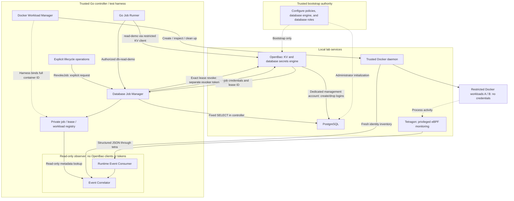

# RunawayBao

**Temporary credentials, isolated workloads, and runtime events linked by job identity.**

RunawayBao is an experimental Go-based runtime security and credential-management
prototype built with OpenBao, PostgreSQL, Docker, and Tetragon's eBPF process
observability. It associates individual jobs with short-lived database credentials
and correlates observed process executions with the correct job and credential lease.

Three milestones have been demonstrated against live local services: authorized
job execution and restricted KV access, independent PostgreSQL credentials with
selective revocation, and read-only Tetragon event correlation.

**Runtime threat detection, security policy decisions, and event-driven credential
revocation are planned.** Today, PostgreSQL queries execute in the Go controller;
a separate, secret-free Docker workload phase supplies the monitored processes.

## Why RunawayBao?

Secrets managers control credential issuance, lifetime, and revocation. Runtime
security tools observe what processes do. Connecting these capabilities requires
more than identifying an unexpected executable: a response must target the
credential belonging to the affected workload.

RunawayBao investigates that connection through an explicit mapping:

```text
Tetragon event → verified Docker workload identity → job ID → OpenBao lease
```

Incorrect attribution could revoke an unrelated job's access. The prototype
therefore establishes credential isolation and conservative event correlation
before adding security decisions or automated responses. A correlated execution
is an attribution result, not evidence of malicious behavior.

## Architecture

The live test harness coordinates the components below. The boundaries describe
logical responsibilities; the trusted harness is not an operating-system sandbox.



The database phase and monitored container phase belong to the same job record,
but execute separately. Credentials are not injected into the Docker workloads.
There is no event-to-revocation path. The runner is a Go library with demonstration
entry points, not an authenticated job submission service or production scheduler.

## Current capabilities

### Milestone 1 — Go Runner and OpenBao KV

The [job runner](jobrunner/runner.go) validates requests, applies exact permission
grants, and prevents duplicate IDs within a runner instance. Concurrent calls are
safe; network operations run outside the duplicate-store mutex.

| Action | Required permission | Behavior |
|---|---|---|
| `succeed` / `fail` | `mock:execute` | Deterministic mock outcomes; no external execution |
| `read-demo` | `secret:read-demo` | Reads the fixed OpenBao KV v2 demo secret |
| `db-read-demo` | `database:read-demo` | Delegates to the database job manager from Milestone 2 |

Requests contain only `ID` and `Action`. Blank requests do not reserve IDs; valid
submissions reserve their IDs even when denied or failed. Duplicate protection is
in memory. Grants come from trusted application code; there is no authentication
layer. Use `RunContext` for cancellable KV/database operations. Mock outcomes
remain deterministic and do not inspect the context.

The [KV client](openbao/client.go) accepts an explicitly supplied restricted token
and reads only `/v1/secret/data/demo`. It honors cancellation and timeouts, rejects
redirects, bounds responses, and returns sanitized errors. Job results contain
status and fixed error messages, never returned credentials or lease IDs.

### Milestone 2 — PostgreSQL dynamic credentials

The [database job manager](databasejob/manager.go) obtains a separate credential
lease for each job and retains credentials privately in memory. Its registry
records job ID, lease ID, issue time, TTL, lifecycle state, and optional workload ID.

Each database operation opens a fresh local connection, runs the fixed query
`SELECT value FROM demo.fixture WHERE id = 1`, checks the fixture, and closes the
connection. Jobs cannot supply SQL, database addresses, or OpenBao role names.
The live role has a two-minute default TTL and five-minute maximum.

Lease lifecycle is explicit:

- Successful execution retains its lease until explicit cleanup or expiry.
- Execution failures or post-issuance cancellation trigger bounded cleanup for
  known leases with a fresh context. Cleanup failures are reported separately.
- `RevokeJob` resolves the job's stored lease and submits synchronous exact-lease
  revocation. Confirmed repeats are no-ops; failed attempts remain retryable.
- Only a synchronous OpenBao HTTP 204 marks a lease revoked and clears its stored
  credentials. An elapsed TTL alone is not confirmation.
- `Close` rejects new execution and attempts remaining lease cleanup. Callers must
  cancel and join active operations first, inspect failures, and retry as needed.

The [live database test](databasejob/live_integration_test.go) demonstrates that
revoking A prevents fresh authentication with A's original credentials while B
continues to read with its original credentials.

### Milestone 3 — Tetragon runtime correlation

The [workload manager](workload/docker.go) creates restricted Alpine containers.
The trusted harness binds each full Docker ID to its job before start, then
activates the binding using Docker's exact start timestamp. Workload bindings
are unique and immutable. The controlled workload command launches a shell and
its child process; the database query still runs in the controller.

The [event consumer](runtimeevents/consumer.go) supervises JSON output from the
installed `tetra getevents` CLI. It handles cancellation, malformed/oversized
frames, reconnects, and observation gaps. Unknown event types are counted rather
than interpreted as process execution events. Raw arguments and environment data
are discarded rather than logged.

The [correlator](runtimeevents/correlator.go) attributes an execution only when its
container identity resolves unambiguously against trusted metadata:

- This Docker/WSL environment emits a **31-character `process.docker` prefix**.
  The implementation supports that format and full 64-character IDs; supplied
  full container metadata must agree with the prefix.
- Potential matches require a fresh complete Docker inventory, including unrelated
  stopped containers, plus retained bindings for collision checks.
- Missing, conflicting, ambiguous, unknown, or unverifiable identities remain
  `uncorrelated`. Executable names, labels, and PIDs alone never identify a job.
- A child's own container identity is required. Parent identity cannot fill in a
  missing child identity. Execution IDs support deduplication without confusing
  PID reuse with a new execution.
- Restart counts or changed start timestamps invalidate the container generation.
  Execution timestamps must fall within its known lifetime. Delayed and
  out-of-order events can be marked late; retired history expires after two minutes.

The observer receives a read-only metadata lookup, not an OpenBao client, revoker,
manager instance, or token. It reports attribution and coverage gaps without
threat classification or enforcement.

## Security model

### Privilege separation

Bootstrap and normal job access use different credentials. The test harness
provisions narrowly scoped tokens without the default policy; application clients
cannot infer an opaque token's privileges, so correct configuration remains a
trusted setup responsibility.

| Credential / role | Authority |
|---|---|
| OpenBao development root token | Test setup, inspection, teardown, and optional manual dummy-secret scripts |
| PostgreSQL administrator | Container initialization |
| PostgreSQL management account | OpenBao plugin access; non-superuser with `CREATEROLE` and authority to grant the reader group |
| KV reader token | Read only `secret/data/demo` |
| Database issuer token | Read only the configured `<mount>/creds/reader` endpoint |
| Database revoker token | Update only exact lease paths beneath the dedicated role; only `sync=true` is permitted in the request body |
| Generated database login | Connect, use the demo schema, and select the fixture table |
| Runtime observer | Read-only event and identity metadata; no OpenBao credentials or revocation interface |

The revoker policy excludes body lease-ID overrides, prefix/force revocation,
and token-revocation endpoints. The runtime correlation harness creates no
revoker policy or token. Its credentials expire naturally before bootstrap teardown.
See the [OpenBao database API](https://openbao.org/docs/api/secret/databases/)
and [lease API](https://openbao.org/docs/api/system/leases/).

### Database and workload boundaries

[PostgreSQL initialization](postgres/init.sh) removes public connection, temporary
object, and schema privileges in the demo database. Dynamic logins inherit the
reader group, own no objects, and cannot write, create schema objects, create
roles, or read the restricted fixture table.

Observation containers run as UID/GID 65534 with no network, no capabilities,
no host binds or host namespaces, a read-only root filesystem, and
`no-new-privileges`. Limits are 64 MiB memory, 0.25 CPU, 32 PIDs, and a 16 MiB
`noexec,nosuid` temporary filesystem. The Alpine version tag resolves to an
immutable local image ID before creation. Workloads receive no Docker socket,
OpenBao tokens, or database passwords.

The controller and Docker daemon are trusted. Docker access grants extensive
host authority; the observer's read-only behavior is a code boundary, not an
OS-enforced restriction on Docker privileges. Tetragon separately runs privileged
with host PID/cgroup namespaces and kernel/BPF/runtime mounts. Compose project
isolation does not isolate its host-wide instrumentation.

### Attribution and sensitive data

Fail-closed correlation means **refusing uncertain attribution**, not blocking
workload execution or revoking access. Prefix resolution depends on trusted
Docker inventory and retained history; it is not full-identity proof.

Application errors and job results omit credentials, connection strings, and raw
sensitive diagnostics. Observer output also omits lease IDs and raw event payloads.
Use non-sensitive job IDs: they are echoed in results. Keep registry metadata,
configuration structs, and returned credentials out of ordinary logs. Go strings
cannot be reliably erased from memory.

## Getting started

### Prerequisites

- Go 1.22 or newer; the PostgreSQL client uses `pgx/v5`. Initial module downloads
  require network access. Offline tests need no Docker or `.env`, but open local
  HTTP fixture sockets. The race detector requires a supported Go/CGO environment.
- Docker Engine or Docker Desktop with Compose v2, accessible as your user.
- Bash, `curl`, and standard Linux utilities for the scripts.
- For Tetragon: a compatible Linux Docker host with eBPF/BTF support and the
  kernel, BPF, and runtime mounts used in [compose.yaml](compose.yaml).

On Docker Desktop/WSL2, enable integration for the WSL distribution and run from
that distribution. Tetragon observes the Docker Linux VM's processes, not Windows
processes. Other host/kernel combinations require validation.

### Configure and start the lab

From the repository root:

```bash
go version
docker info
test -f .env || cp .env.example .env
chmod 600 .env
./scripts/start.sh
./scripts/status.sh
docker compose -p runawaybao -f compose.yaml ps
```

[.env.example](.env.example) contains disposable development placeholders. Use only
fake data in this lab. `.env` is ignored by Git; never force-add it. Scripts source
it as trusted shell code.

| Variable | Purpose / default |
|---|---|
| `BAO_TOKEN` | Bootstrap development root token; not a normal job token |
| `BAO_PORT` | OpenBao loopback host port; defaults to `8200` |
| `POSTGRES_PORT` | PostgreSQL loopback host port; defaults to `15432` |
| `POSTGRES_PASSWORD` | Disposable PostgreSQL administrator bootstrap password |
| `DB_MANAGER_PASSWORD` | Disposable OpenBao database management-account password |

Change conflicting ports in `.env`; the verified lab used OpenBao port `18200`.
Do not stop unrelated containers to free a port. Scripts pin Compose project
`runawaybao` and the repository's configuration file. Reserve that project name
for one lab; separate clones share the same name.

`start.sh` creates/starts all three services and polls readiness. PostgreSQL's
init script creates its schema and roles on initialization. Starting services
alone does not configure the OpenBao database engine: each live test creates its
own temporary engine mount, connection, roles, and policies.

### Run the demonstrations

```bash
# Fixed JSON examples: success, denial, simulated failure, unknown action.
go run ./cmd/mock-runner

# Live restricted KV access and ACL checks; requires the lab already running.
./scripts/test-openbao-acl.sh

# Live per-job PostgreSQL credentials and explicit selective lease revocation.
./scripts/test-database.sh

# Live Docker/Tetragon correlation; does not request job lease revocation.
./scripts/test-runtime-correlation.sh
```

Run live suites sequentially against the disposable lab, with shell tracing off.
The database script starts OpenBao/PostgreSQL if needed. The runtime script starts
all services and pulls `alpine:3.22`. Both configure temporary OpenBao resources.
The runtime test launches A, B, and an owned but unregistered container, waits for
observations, interrupts/reconnects the stream, verifies continued database access,
and removes its containers. Natural credential/token expiry makes it take about
two minutes; event delivery can be delayed on this host.

Optional manual tools are also available:

| Tool | Purpose / resource effects |
|---|---|
| `scripts/put-demo-secret.sh` | Uses the bootstrap token to write the fixed dummy KV fixture |
| `scripts/read-demo-secret.sh` | Uses the bootstrap token and prints the dummy response; never use with real secret data |
| `scripts/test-process.sh` | Compact, text-filtered manual event viewer; not the structured correlation consumer |
| `cmd/observe-jobs` | Attaches the observer to existing trusted bindings; does not provision jobs or credentials |

The standalone observer accepts a private JSON array with `job_id`, `workload_id`
(full Docker ID), `lease_id`, and `started_at` (exact Docker `StartedAt`) fields.
A trusted coordinator must supply these records. Keep the file mode `0600` and
outside version control. With a valid file already prepared:

```bash
go run ./cmd/observe-jobs /path/to/private-bindings.json
```

It verifies container generations before attaching and prints correlation status,
reason, job ID, late-event indicator, and observation generation. It omits lease
IDs and raw event payloads. The complete two-phase orchestration currently lives
in the integration harness, not this CLI.

### Cleanup and troubleshooting

Successful live suites remove their temporary mounts/policies and fixture data
as applicable. The database suite explicitly cleans up leases and test tokens;
the runtime suite waits for natural expiry before removing configuration. The
workload manager removes only recorded container IDs with its random ownership
label. Services remain running after tests.

```bash
./scripts/stop.sh
```

This removes the `runawaybao` Compose containers and network. PostgreSQL uses
tmpfs; stopping its container loses its data and generated logins. Stopping
OpenBao's dev server loses secrets, tokens, policies, and lease records. After
state loss, recreate the disposable lab and rerun setup/tests.

Forced termination or connectivity loss can prevent cleanup. Inspect only this
project's test-owned resources before recovery; do not use broad Docker pruning.
Changing initialization SQL or bootstrap passwords requires fresh PostgreSQL
initialization.

If startup fails, first check Docker access, WSL integration, port conflicts, and
kernel/mount compatibility. Health checks do not prove event delivery; run the
live correlation test. Inspect OpenBao logs privately: development startup logs
can expose the root token. Never publish unredacted logs or resolved Compose
configuration. If another Tetragon instance owns the host instrumentation,
coordinate its shutdown rather than bypassing its PID-file guard.

## Live verification

Live validation completed on **2026-11-17** using Docker Desktop 29.7.2, OpenBao
2.7.1, PostgreSQL 17.12, and Tetragon 1.7.0 in the local WSL laboratory. These are
observed test results, not production guarantees or benchmarks.

| Area | Verified behavior | Validation |
|---|---|---|
| Runner | Authorization, duplicate handling, cancellation, and safe failure results | Unit / HTTP fixture / race tests |
| OpenBao KV | Restricted reads succeed; updates and reads of another existing key receive 403; revoked token is rejected | Live `TestLiveACL` |
| PostgreSQL | A/B receive distinct usernames and lease IDs; both perform the fixed read | Live `TestLiveDatabase` |
| Database authorization | Writes, restricted-table reads, DDL, and role creation are denied | Live `TestLiveDatabase` |
| Revocation | Exact revocation of A rejects fresh authentication; B remains functional; repeats and expiry are handled | Live `TestLiveDatabase` |
| Tetragon | Structured execution events from restricted containers are received | Live source and runtime tests |
| Correlation | A/B shells and controlled children map to their own containers, jobs, and leases | Live `TestLiveRuntime` |
| Unknown events | Unregistered-container and unrelated events remain uncorrelated | Live `TestLiveRuntime` |
| Stream interruptions | Gap recorded, reconnection succeeds, and subsequent A execution correlates | Live `TestLiveRuntime` |
| Credential preservation | Both original database credentials still read after observation | Live `TestLiveRuntime` |
| Cleanup | Owned containers removed; leases expire; post-test inspections found no temporary test mounts, policies, or generated roles | Live suites and cleanup inspection |

Ambiguous/conflicting identities, PID reuse, restart invalidation, duplicates,
out-of-order events, and processing limits are covered by unit tests. Those
synthetic cases are not claimed as live fault-injection results. Standalone
source tests also verified reader cleanup; the restricted lifecycle test verified
create/start/child execution/stop/remove.

Full parent-graph reconstruction remains unverified; child attribution uses its
own verified container identity. Fresh-clone portability to other hosts and the
standalone observer CLI's complete workflow have not been established by these
live suites.

## Testing

Run from the repository root:

```bash
go test ./...
go test -race ./...
go vet ./...
go vet -tags=integration ./...
```

These checks passed during milestone verification. Tests use Go's standard
`testing` package, local HTTP fixtures, and injected dependencies. They cover
request authorization, credential-client behavior, isolated lease state, cleanup
failures/retries, cancellation, identity resolution, process deduplication, and
bounded stream processing.

The live suites require Docker, the local services, `.env`, and disposable data:

```bash
./scripts/test-openbao-acl.sh
./scripts/test-database.sh
./scripts/test-runtime-correlation.sh
```

The scripts enable the `integration` build tag and the corresponding explicit
opt-in variables. Compiling or running tagged tests alone does not enable them:

```bash
go test -tags=integration ./...
```

Without opt-in, live tests **skip**. A skipped suite is not live verification.

For focused, credential-free diagnostics after the lab is running and
`alpine:3.22` is available locally:

```bash
RUNAWAYBAO_TETRA_SOURCE_INTEGRATION=1 go test -tags=integration ./runtimeevents -run '^TestLive' -count=1 -v
RUNAWAYBAO_WORKLOAD_INTEGRATION=1 go test -tags=integration ./workload -run '^TestLiveLifecycle$' -count=1 -v
```

These opt-ins observe Tetragon and/or create restricted test-owned containers;
they do not provision OpenBao credentials. See the source tests for timeouts and
cleanup behavior.

## Reliability and limitations

- **Volatile state:** job IDs, credentials, leases, and bindings are tracked in
  memory. There is no durable audit store, restart recovery, or reconciliation.
  Runner/manager history grows for the instance lifetime.
- **Lease lifecycle:** no automatic renewal or application-level issuance retry. A lost issuance
  response may leave an unknown lease until expiry. After OpenBao dev-mode state
  loss, acknowledging an absent lease cannot prove PostgreSQL cleanup.
- **Authentication versus sessions:** revocation and password expiry are tested
  against fresh authentication. Existing PostgreSQL sessions are not necessarily
  terminated; this client closes its own connection after each operation.
- **Observation gaps:** reconnects do not replay historical Tetragon events. Queue
  overflow, malformed frames, reported source loss, and interruptions record gaps;
  silent upstream loss may still occur. No event is not proof of no activity.
- **Bounded correlation:** limits include 1 MiB frames, 256 queued notices, 64 recent
  gap records, 64 bindings, 4096 deduplication entries, and 256 containers per
  inventory. Deduplication/retired history lasts two minutes. Capacity exhaustion
  refuses admission/attribution; eviction limits historical coverage.
- **Prefix identity:** uniqueness depends on current Docker inventory and retained
  bindings, not a complete history of unrelated removed containers. An adversarial
  Docker administrator is outside the trust model. Stronger identity assurance
  is needed before using these results as an enforcement foundation.
- **Lineage and clocks:** immediate parent metadata was incomplete in this
  environment. Lifecycle checks use `process.start_time`, not event envelope time
  or WSL receipt time. Startup events before binding activation stay uncorrelated.
- **Stream lifecycle:** a remote 180-second reader timeout bounds orphan lifetime
  after connectivity failures and introduces periodic reconnect gaps in longer
  sessions. Context cancellation reaps the local reader.
- **Execution scope:** database work stays in the controller. Containers perform
  a fixed observation command; there is no arbitrary workload API, production
  scheduling, persistence, retries, or authenticated submission endpoint.
- **Response scope:** no threat detection, dry-run policy evaluation, or automatic
  event-driven revocation. Explicit revocation and ordinary failure cleanup exist
  independently of the observer.
- **Local development only:** OpenBao dev mode, placeholder bootstrap credentials,
  privileged monitoring, and plaintext local database connections are unsuitable
  for production. The PostgreSQL client accepts loopback IP addresses only.

For Tetragon's supported event interfaces, see its
[events documentation](https://tetragon.io/docs/concepts/events/).

## Roadmap

| Milestone | Status | Scope |
|---|---|---|
| 1 — Runner and OpenBao KV | Completed | Authorized actions, duplicate prevention, restricted KV reads |
| 2 — PostgreSQL credentials | Completed | Per-job dynamic credentials, lease isolation, explicit selective revocation |
| 3 — Runtime correlation | Completed | Restricted Docker phase, structured Tetragon ingestion, read-only workload attribution |
| 4 — Policy evaluation | Planned | Explicit security policies and dry-run decisions, with uncertainty handling |
| 5 — Controlled response | Planned | Carefully scoped event-driven credential revocation after correlation/policy validation |
| Future — Monitored database worker | Planned | Move database operations into observed workloads through a safe credential channel |
| Future — Operational durability | Planned | Durable state, recovery, audit records, and stronger operational controls |

## Project structure

```text
.
├── cmd/
│   ├── mock-runner/main.go              # Fixed mock demonstration
│   └── observe-jobs/main.go             # Observer for private controller bindings
├── jobrunner/                          # Validation, authorization, dispatch, duplicate IDs
├── openbao/                            # Restricted KV, credential issuance, exact revocation
├── databasejob/                        # Credentials, lease registry, fixed PostgreSQL read
│   ├── live_integration_test.go         # Live bootstrap and database isolation scenario
│   └── runtime_integration_test.go      # Two-phase job/runtime correlation scenario
├── workload/                           # Restricted Docker lifecycle and metadata inspection
├── runtimeevents/                      # JSON ingestion, gaps, conservative correlation
├── postgres/init.sh                    # Demo schema and database role bootstrap
├── scripts/
│   ├── common.sh                       # Trusted environment and explicit Compose scope
│   ├── start.sh / status.sh / stop.sh   # Lab lifecycle and health probes
│   ├── test-openbao-acl.sh              # Live restricted KV scenario
│   ├── test-database.sh                 # Live credential isolation and revocation
│   ├── test-runtime-correlation.sh      # Live read-only observation scenario
│   ├── test-process.sh                 # Manual text-filtered Tetragon viewer
│   └── put-demo-secret.sh / read-demo-secret.sh
├── compose.yaml                        # OpenBao, PostgreSQL, Tetragon
├── .env.example                        # Disposable local bootstrap configuration
├── go.mod / go.sum                     # Go module and dependency checksums
└── LICENSE
```

Package directories include unit tests; live tests are guarded by the
`integration` build tag and explicit opt-in. Small interfaces separate issuance,
revocation, database reads, and metadata lookup so each boundary can be tested
without coupling observation to enforcement.

## License

[MIT](LICENSE)
