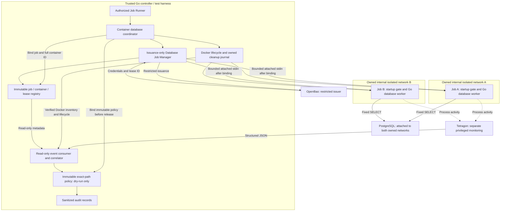

# RunawayBao

**Link temporary credentials to workload identity and runtime activity.**

RunawayBao is an experimental Go security prototype combining OpenBao, PostgreSQL,
Docker, and Tetragon's eBPF observability. It demonstrates per-job database
credentials, selective lease revocation, read-only runtime event correlation, and
deterministic execution-policy evaluation in dry-run mode.

Secrets management controls access; runtime monitoring observes behavior. Connecting
them safely requires knowing **which workload owns which credential lease**. An
incorrect attribution could revoke an unrelated job's access. RunawayBao establishes
that mapping before introducing automated security responses. Policies can now produce audit-only
findings; no response is executed.

## Current architecture



**Milestone 5 executes the database reads inside the monitored containers.**
A bootstrap gate delays the worker until immutable job/container/lease and policy
bindings are established. Credentials travel only over attached, non-TTY stdin:
strict JSON frames are capped at 16 KiB, exchanges have a 10-second deadline,
and uncertain delivery is never automatically resent. The new
coordinator has no revoker, and the observer and evaluator remain read-only.
The earlier controller-query demonstrations remain available as regression tests.
See the [full architecture](docs/architecture.md) and
[security model](docs/security-model.md).

## Implemented and live-verified

| Milestone | What works today |
|---|---|
| 1 — Runner and OpenBao KV | Authorized actions, in-memory duplicate prevention, context-aware secret operations, restricted KV reads, secret-free results |
| 2 — PostgreSQL credentials | Unique per-job credentials and leases, least-privilege reads, internal registry, exact selective revocation without disrupting another job |
| 3 — Runtime correlation | Restricted Docker workloads, structured Tetragon events, conservative container-to-job-to-lease attribution, deduplication, bounded processing, reconnect/gap reporting |
| 4 — Dry-run policies | Immutable per-workload exact-path allowlists, deterministic allowed/suspicious/unknown outcomes, sanitized audit records, explicit gap/lifecycle handling; no enforcement |
| 5 — Containerized database workloads | Fixed Go worker, private stdin delivery, startup gate, per-job isolated internal networks, retained cleanup journal, PostgreSQL-side query-origin checks; dry-run only |

The runner is a Go library with demonstration entry points, not an authenticated
submission service or general-purpose scheduler. Unknown or ambiguous identities
remain uncorrelated. Successful correlation does not classify a process as malicious.

## Quick start

Use a disposable Linux Docker lab with Go 1.22+, Docker Compose v2, Bash, and `curl`.
Tetragon requires a compatible eBPF/BTF-enabled kernel and privileged host monitoring.
For Docker Desktop/WSL2, enable integration for your distribution. See
[prerequisites and configuration](docs/testing.md#getting-started) for details.

From the repository root:

```bash
go version
docker info
test -f .env || cp .env.example .env
chmod 600 .env
./scripts/start.sh
./scripts/status.sh
go run ./cmd/mock-runner
```

Use only disposable placeholders from `.env.example`; keep `.env` private. OpenBao
and PostgreSQL bind to loopback. Change conflicting ports in `.env` before startup.

Run the live demonstrations separately:

```bash
./scripts/demo.sh credentials  # Explicitly revoke A; verify B still works.
./scripts/demo.sh correlation  # Observe A/B; keep both credentials working.
./scripts/demo.sh policy       # Evaluate A/B policies; recommendations are audit-only.
./scripts/demo.sh container-database # Real monitored database workers (Milestone 5).
```

`./scripts/demo.sh all` retains its original credential-plus-correlation sequence.
The `policy` and `container-database` modes are selected separately. The wrapper
preserves actual test output and exit status. The correlation test takes about two minutes because it
waits for natural credential expiry before teardown. Services remain running.
See the [demo and recording guide](docs/demo.md) for expected checkpoints and
resource effects, and the [testing guide](docs/testing.md) for individual suites.

```bash
./scripts/stop.sh
```

Stopping the lab discards PostgreSQL tmpfs data and OpenBao development state.
Tests clean up their own resources; do not use broad Docker pruning.

## Live verification

Local live verification completed on **2026-11-17** with Docker Desktop 29.7.2,
OpenBao 2.7.1, PostgreSQL 17.12, and Tetragon 1.7.0:

- Jobs A and B received distinct credentials and leases and completed authorized reads.
- Unauthorized SQL operations were denied. Exact revocation of A rejected fresh
  authentication while B continued to read with its original credentials.
- A/B shells and controlled child executions mapped to their own workloads, jobs,
  and leases. Unregistered and unrelated events remained uncorrelated.
- Stream interruption produced a recorded gap; reconnection restored observation.
  Both original database credentials remained usable during the observation scenario.
- Test-owned workloads and temporary configuration were cleaned up.

Authorization, cancellation, ambiguous identities, PID reuse, duplicates, restart
handling, and processing limits also have unit/fixture coverage. These synthetic
cases are distinct from live fault-injection results. See the
[verification matrix](docs/testing.md#live-verification).

Milestone 4 was also verified live on **2026-11-18**: exact workload paths matched
A's allowlist; B's shell produced `suspicious` with audit-only
`would_revoke_lease`; unknown inputs remained untargeted; and both original
database credentials continued to work after evaluation. Descriptor-based startup
records were classified as unknown rather than allowed. See the
[policy model and limitations](docs/policy.md).

Milestone 5 was live-verified on **2026-11-18**, including a race-instrumented
controller run. PostgreSQL confirmed separate container-origin sessions before
and after dry-run evaluation. Tetragon emitted `/runawaybao-db-worker` and
`/runawaybao-unexpected` with the observed 31-character Docker identity prefix;
B's child mapped only to B. Raw event, Docker inspection/log, job-result and audit
checks found no tested credential values. Failure injection retained leases and
ownership journals; cleanup and natural expiry passed.

Selected TCP probes confirmed blocked worker-to-worker access in both directions,
OpenBao access, external IPv4 access, and the Docker Desktop host's published
OpenBao port, with reachable controls. DNS, UDP, other host services and privileged
host access are outside these verified isolation claims. See the detailed
[test evidence and limits](docs/testing.md#milestone-5-containerized-database-verification).

## Testing and CI

```bash
go test ./...
go test -race ./...
go vet ./...
go test -tags=integration -run '^$' ./...
go vet -tags=integration ./...
```

[GitHub Actions](.github/workflows/ci.yml) runs these checks on pushes and pull
requests, plus shell syntax and whitespace checks. Go comes from `go.mod`, with
module/build caching. Standard CI needs no repository secrets, live services, or
privileged containers. The integration-tag compile check runs no test bodies.
Local HTTP fixtures require loopback sockets; CI runs them normally on Ubuntu.

Live suites are opt-in and run separately; a skipped suite is not live verification.
See [testing and local setup](docs/testing.md) and [contributing](CONTRIBUTING.md).

## Limitations

This is a local prototype, not production-ready secret-management infrastructure.
Tracking is in memory, with no durable recovery, automatic lease renewal, or event
replay. Prefix-based correlation depends on trusted Docker metadata and bounded
history; parent lineage was incomplete in this environment. Revocation is verified
against new authentication, not termination of existing PostgreSQL sessions.
Docker/controller privileges and privileged Tetragon monitoring remain trust boundaries.

There is no general threat detection or event-driven revocation. Policy violations
are dry-run findings, not proof of malicious intent.
The new live path requires Docker bridge `isolated` gateway mode. Network probes
cover selected endpoints, not every host service or DNS exfiltration path. Read the
[security model and full limitations](docs/security-model.md) before extending the lab.

## Strong workload identity

The opt-in identity test matches Tetragon's event-time PID and cgroup namespace
pair to a pinned, Docker-verified workload generation. Existing prefix correlation
continues to support observation. Strong assurance is a dry-run correlation
result and grants no permission to act on a credential.

```bash
./scripts/test-container-database.sh identity
```

See [runtime correlation and identity assurance](docs/policy.md#workload-identity-assurance)
for the distinction and its trust assumptions.

## Roadmap

| Milestone | Status |
|---|---|
| 1 — Authorized runner and restricted OpenBao KV | Completed |
| 2 — Dynamic PostgreSQL credentials and selective revocation | Completed |
| 3 — Tetragon ingestion and workload correlation | Completed |
| 4 — Explicit policy evaluation and dry-run decisions | Completed |
| 5 — Containerized database workloads, dry-run only | Completed |
| 6A — Strong workload identity validation | Completed, verified in the local Docker Desktop lab |
| 6B — Controlled enforcement | Planned |
| Durable state, recovery, audit records, and stronger operational controls | Future |

## Documentation

- [Architecture, capabilities, and project structure](docs/architecture.md)
- [Security model and reliability limits](docs/security-model.md)
- [Local setup, tests, and live verification](docs/testing.md)
- [Demonstrations and optional terminal recording](docs/demo.md)
- [Dry-run policy model and audit semantics](docs/policy.md)
- [Contribution guide](CONTRIBUTING.md)

## License

[MIT](LICENSE). The existing license is unchanged.
