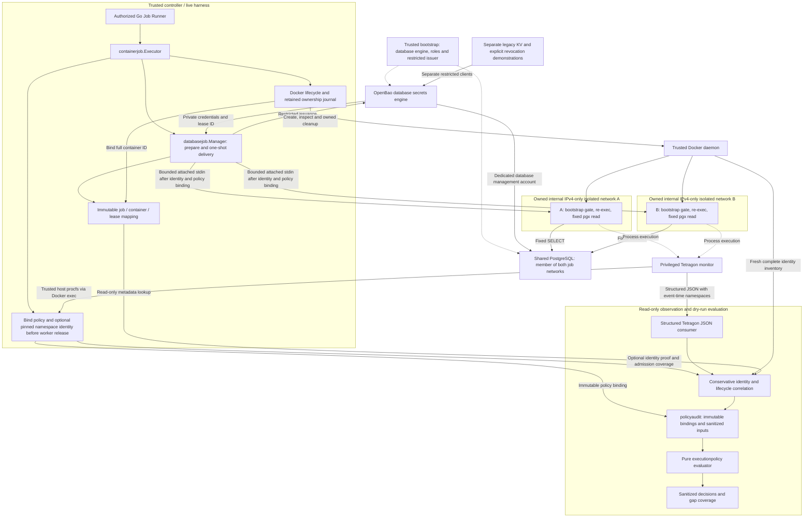

# Architecture and implementation

[Back to the project overview](../README.md)

## Why RunawayBao?

Secrets managers control credential issuance, lifetime, and revocation. Runtime
security tools observe what processes do. Connecting these capabilities requires
more than identifying an unexpected executable: a response must target the
credential belonging to the affected workload.

RunawayBao investigates that connection through an explicit mapping:

```text
Tetragon event → verified Docker workload identity → job ID → OpenBao lease
```

Incorrect attribution could revoke an unrelated job's access. The prototype
therefore establishes credential isolation and conservative event correlation
before adding security decisions or automated responses. A correlated execution
is an attribution result, not evidence of malicious behavior.

## Architecture

The live test harness coordinates the components below. The boundaries describe
logical responsibilities; the trusted harness is not an operating-system sandbox.



Milestone 5 unifies database execution and monitoring in the same container.
Milestones 2–4 retain their original controller-query demonstrations for regression.
There is no event-to-revocation path. The runner remains a library with laboratory
entry points, not an authenticated submission service or scheduler.

## Current capabilities

### Milestone 1 — Go Runner and OpenBao KV

The [job runner](../jobrunner/runner.go) validates requests, applies exact permission
grants, and prevents duplicate IDs within a runner instance. Concurrent calls are
safe; network operations run outside the duplicate-store mutex.

| Action | Required permission | Behavior |
|---|---|---|
| `succeed` / `fail` | `mock:execute` | Deterministic mock outcomes; no external execution |
| `read-demo` | `secret:read-demo` | Reads the fixed OpenBao KV v2 demo secret |
| `db-read-demo` | `database:read-demo` | Delegates to the configured controller or container database executor |

Requests contain only `ID` and `Action`. Blank requests do not reserve IDs; valid
submissions reserve their IDs even when denied or failed. Duplicate protection is
in memory. Grants come from trusted application code; there is no authentication
layer. Use `RunContext` for cancellable KV/database operations. Mock outcomes
remain deterministic and do not inspect the context.

The [KV client](../openbao/client.go) accepts an explicitly supplied restricted token
and reads only `/v1/secret/data/demo`. It honors cancellation and timeouts, rejects
redirects, bounds responses, and returns sanitized errors. Job results contain
status and fixed error messages, never returned credentials or lease IDs.

### Milestone 2 — PostgreSQL dynamic credentials

The [database job manager](../databasejob/manager.go) obtains a separate credential
lease for each job and retains credentials privately in memory. Its registry
records job ID, lease ID, issue time, TTL, lifecycle state, and optional workload ID.

In the retained Milestone 2 path, each database operation opens a fresh local connection, runs the fixed query
`SELECT value FROM demo.fixture WHERE id = 1`, checks the fixture, and closes the
connection. Jobs cannot supply SQL, database addresses, or OpenBao role names.
The live role has a two-minute default TTL and five-minute maximum.

The legacy controller-query lease lifecycle is explicit (Milestone 5 uses the
separate preparation/delivery lifecycle below):

- Successful execution retains its lease until explicit cleanup or expiry.
- Execution failures or post-issuance cancellation trigger bounded cleanup for
  known leases with a fresh context. Cleanup failures are reported separately.
- `RevokeJob` resolves the job's stored lease and submits synchronous exact-lease
  revocation. Confirmed repeats are no-ops; failed attempts remain retryable.
- Only a synchronous OpenBao HTTP 204 marks a lease revoked and clears its stored
  credentials. An elapsed TTL alone is not confirmation.
- `Close` rejects new execution and attempts remaining lease cleanup. Callers must
  cancel and join active operations first, inspect failures, and retry as needed.

The [live database test](../databasejob/live_integration_test.go) demonstrates that
revoking A prevents fresh authentication with A's original credentials while B
continues to read with its original credentials.

### Milestone 3 — Tetragon runtime correlation

The [workload manager](../workload/docker.go) creates restricted Alpine containers.
The trusted harness binds each full Docker ID to its job before start, then
activates the binding using Docker's exact start timestamp. Workload bindings
are unique and immutable. The controlled workload command launches a shell and
its child process; in this retained Milestone 3 scenario the query runs in the
controller. Milestone 5 instead observes the actual database worker.

The [event consumer](../runtimeevents/consumer.go) supervises JSON output from the
installed `tetra getevents` CLI. It handles cancellation, malformed/oversized
frames, reconnects, and observation gaps. Unknown event types are counted rather
than interpreted as process execution events. Raw arguments and environment data
are discarded rather than logged.

The [correlator](../runtimeevents/correlator.go) attributes an execution only when its
container identity resolves unambiguously against trusted metadata:

- This Docker/WSL environment emits a **31-character `process.docker` prefix**.
  The implementation supports that format and full 64-character IDs; supplied
  full container metadata must agree with the prefix.
- Potential matches require a fresh complete Docker inventory, including unrelated
  stopped containers, plus retained bindings for collision checks.
- Missing, conflicting, ambiguous, unknown, or unverifiable identities remain
  `uncorrelated`. Executable names, labels, and PIDs alone never identify a job.
- A child's own container identity is required. Parent identity cannot fill in a
  missing child identity. Execution IDs support deduplication without confusing
  PID reuse with a new execution.
- Restart counts or changed start timestamps invalidate the container generation.
  Execution timestamps must fall within its known lifetime. Delayed and
  out-of-order events can be marked late; retired history expires after two minutes.

The observer receives a read-only metadata lookup, not an OpenBao client, revoker,
manager instance, or token. It reports attribution and coverage gaps without
threat classification or enforcement.

## Milestone 4 — Dry-run policy evaluation

The optional policy path follows verified correlation. `executionpolicy` compiles
immutable Go allowlists and evaluates normalized values without I/O or infrastructure
dependencies. `policyaudit` binds policy versions to workload IDs, selects sanitized
facts, and writes JSON audit output. Neither layer receives a revoker or workload
termination interface. Correlation-only CLI behavior remains the default.

Policy admission precedes workload start in the live coordinator. Terminated and
active out-of-order records are distinguished, and coverage counters remain visible
when gap notifications are dropped. See the [policy model](policy.md) for outcomes,
path validation, immutable bindings, and the explicit dry-run CLI.

## Milestone 5 — Containerized database workloads

The explicit `container-database` demo selects `containerjob.Executor` through the
existing `jobrunner.DatabaseExecutor` interface. The mock runner, KV client,
legacy manager execution and correlation-only CLI keep their existing behavior.
No new runtime dependencies or services are added.

1. Establish the structured Tetragon stream before job admission.
2. Authorize the existing fixed `db-read-demo` action. `Manager.Prepare` reserves
   the job and issues its private credential without making a database connection.
3. Reserve unique resource names and create an owned internal bridge. Require
   `gateway_mode_ipv4=isolated`, disable IPv6, and attach PostgreSQL as `postgres`.
4. Create the worker from an immutable local image ID with attached stdin and the
   existing UID, capability, filesystem, PID, CPU and memory restrictions.
5. Bind the full Docker ID immutably to the job/lease and validated policy version.
6. Start the bootstrap process; inspect the exact Docker generation and activate
   correlation. The bootstrap blocks for a single release byte; it has no database
   credentials and performs no database operation.
7. Send the gate byte then one strict JSON credential frame on the same attached,
   non-TTY stdin. The bootstrap reads exactly one byte without buffering and
   re-execs `/runawaybao-db-worker worker` with an empty environment. No Docker
   environment, argument, bind mount or temporary credential file is used.
8. The worker accepts only `read`, `demo-child`, and `finish`. `read` opens a fresh
   pgx connection to fixed `postgres:5432/runawaybao`, executes the fixture SELECT,
   and retains the session for private server-side origin inspection. A repeat
   closes the old session and authenticates again with the original credential.
9. Evaluate correlated events in dry-run mode. No decision enters the executor.
10. Normal `finish`, controller cancellation, and owned-resource cleanup are explicit
    lifecycle actions. The live harness waits for natural credential/token expiry
    before deleting its temporary bootstrap configuration. No revoker is created.

The new live role uses a three-minute default TTL (five-minute maximum); legacy
roles retain their two-minute default.

The scratch image builds the worker with the existing pgx driver. Its separate
fixed harmless child and credential-free network probe are laboratory diagnostics;
they accept no SQL, credentials, endpoints from job input, tokens, or lease IDs.

### Framing, bounds and partial outcomes

Frames are newline-delimited JSON, at most 16 KiB, with unknown/duplicate fields,
invalid UTF-8, trailing objects and incomplete frames rejected. Credential fields
are bounded (256-byte username, 4096-byte password). Responses contain only a
fixed status and optional backend PID. Each controller protocol exchange has a
10-second maximum deadline and serializes access to its stream. A protocol error
or cancellation closes and permanently taints the stream; credential delivery is
never automatically retried. Bootstrap waits at most 90 seconds and the worker
process lives at most 180 seconds, including blocked stdin.

`Manager.Deliver` records `not_delivered`, `delivering`, `delivered`, or `uncertain`
without holding its mutex during I/O. Issuance failures retain returned lease
metadata. Uncertain delivery cannot be resent. TTL estimates do not mark a lease
revoked. `NewForWorkloads` has neither a controller query reader nor a revoker.

`workload.Database` reserves names before Docker mutations and retains job,
container name/ID, network name/ID, PostgreSQL ID and phase even after errors or
successful cleanup. Cleanup reconciles exact names and IDs, verifies the random
ownership label, removes only its container, refuses foreign network members,
detaches only the expected PostgreSQL container and removes its network. Failed
cleanup retains a retryable journal. Per-job lifecycle admission rejects overlap;
callers must cancel and join active operations before retrying cleanup. No global
mutex spans network or Docker I/O. Journals are bounded to 32 executions per
coordinator; they are not durable crash recovery.

New code lives in `containerjob/`, `workload/database.go`, `internal/dboperation/`,
`internal/workerprotocol/`, `cmd/db-worker/`, `cmd/demo-child/`, `cmd/network-probe/`,
and `worker/Dockerfile`. The opt-in live coordinator is
`databasejob/container_integration_test.go`; its script is
`scripts/test-container-database.sh`.

## Milestone 6A admission and observation

In the opt-in identity path, the existing bootstrap process waits on stdin.
The controller checks the full Docker ID, owner, init PID, start time, restart
count and namespace modes. It uses the trusted Tetragon container's host procfs
view to verify the init's cgroup v2 path and pin both namespace objects. It
rechecks Docker state before binding the proof and releasing the worker. Docker
Desktop can assign different PID numbers to Docker inspection and event-time
Tetragon observations, so joining those two numeric PIDs is unnecessary here.

The correlator keeps the legacy result and adds a separate assurance result.
The strong path needs the live proof, the event-time namespace pair and Docker
prefix, a matching workload generation, fresh complete Docker inventory,
matching uninterrupted coverage since admission, and a fresh, ordered exec.
The proof is valid only in the current controller lifetime. Cleanup and
controller cancellation release it.

## Milestone status and next phase

Milestones 1–5 are completed and live-verified. Milestone 6A validates stronger
workload identity in a dedicated local dry-run. **Milestone 6B, controlled
enforcement, remains planned.** Identity assurance carries no permission to
revoke a lease or stop a worker.

## Project structure

```text
.
├── .github/workflows/ci.yml             # Unprivileged standard CI
├── docs/                               # Architecture, security, testing, demo guides
├── CONTRIBUTING.md                     # Scope and contribution checks
├── cmd/
│   ├── db-worker/main.go                # Gated fixed PostgreSQL worker
│   ├── demo-child/main.go               # Fixed harmless policy demonstration
│   ├── network-probe/main.go            # Credential-free lab connectivity probe
│   ├── mock-runner/main.go              # Fixed mock demonstration
│   └── observe-jobs/main.go             # Observer for private controller bindings
├── jobrunner/                          # Validation, authorization, dispatch, duplicate IDs
├── openbao/                            # Restricted KV, credential issuance, exact revocation
├── containerjob/                       # Admission and container database lifecycle
├── internal/workerprotocol/            # Bounded private stdin framing
├── internal/dboperation/               # Shared fixed pgx read
├── worker/Dockerfile                   # Minimal scratch worker image
├── .dockerignore                       # Source-only worker build context
├── databasejob/                        # Credentials, lease registry, fixed PostgreSQL read
│   ├── live_integration_test.go         # Live bootstrap and database isolation scenario
│   ├── container_integration_test.go   # Real container database A/B scenario
│   └── runtime_integration_test.go      # Two-phase job/runtime correlation scenario
├── workload/                           # Restricted Docker lifecycle and metadata inspection
├── executionpolicy/                    # Pure immutable allowlists and deterministic decisions
├── policyaudit/                        # Read-only policy adapter and safe audit output
├── runtimeevents/                      # JSON ingestion, gaps, conservative correlation
├── postgres/init.sh                    # Demo schema and database role bootstrap
├── scripts/
│   ├── demo.sh                         # Labeled, sequential live demonstrations
│   ├── common.sh                       # Trusted environment and explicit Compose scope
│   ├── start.sh / status.sh / stop.sh   # Lab lifecycle and health probes
│   ├── test-openbao-acl.sh              # Live restricted KV scenario
│   ├── test-database.sh                 # Live credential isolation and revocation
│   ├── test-container-database.sh       # Live monitored database worker scenario
│   ├── test-runtime-policy.sh           # Live audit-only policy scenario
│   ├── test-runtime-correlation.sh      # Live read-only observation scenario
│   ├── test-process.sh                 # Manual text-filtered Tetragon viewer
│   └── put-demo-secret.sh / read-demo-secret.sh
├── compose.yaml                        # OpenBao, PostgreSQL, Tetragon
├── .env.example                        # Disposable local bootstrap configuration
├── go.mod / go.sum                     # Go module and dependency checksums
└── LICENSE
```

Package directories include unit tests; live tests are guarded by the
`integration` build tag and explicit opt-in. Small interfaces separate issuance,
revocation, database reads, and metadata lookup so each boundary can be tested
without coupling observation to enforcement.

