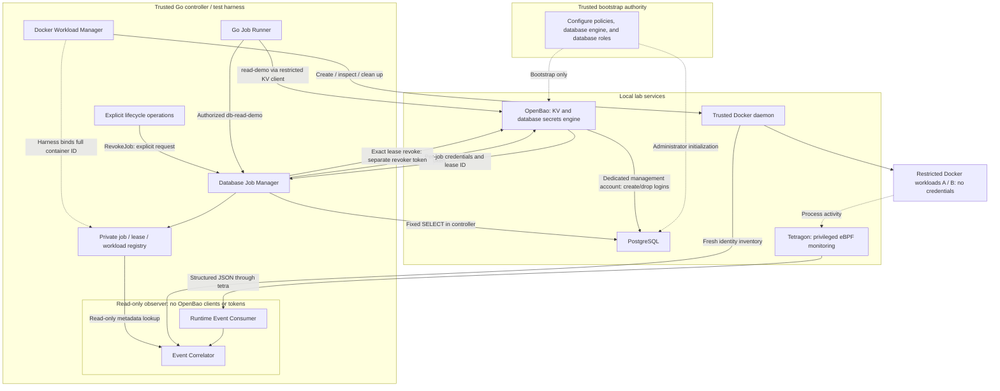

# Architecture and implementation

[Back to the project overview](../README.md)

## Why RunawayBao?

Secrets managers control credential issuance, lifetime, and revocation. Runtime
security tools observe what processes do. Connecting these capabilities requires
more than identifying an unexpected executable: a response must target the
credential belonging to the affected workload.

RunawayBao investigates that connection through an explicit mapping:

```text
Tetragon event → verified Docker workload identity → job ID → OpenBao lease
```

Incorrect attribution could revoke an unrelated job's access. The prototype
therefore establishes credential isolation and conservative event correlation
before adding security decisions or automated responses. A correlated execution
is an attribution result, not evidence of malicious behavior.

## Architecture

The live test harness coordinates the components below. The boundaries describe
logical responsibilities; the trusted harness is not an operating-system sandbox.



The database phase and monitored container phase belong to the same job record,
but execute separately. Credentials are not injected into the Docker workloads.
There is no event-to-revocation path. The runner is a Go library with demonstration
entry points, not an authenticated job submission service or production scheduler.

## Current capabilities

### Milestone 1 — Go Runner and OpenBao KV

The [job runner](../jobrunner/runner.go) validates requests, applies exact permission
grants, and prevents duplicate IDs within a runner instance. Concurrent calls are
safe; network operations run outside the duplicate-store mutex.

| Action | Required permission | Behavior |
|---|---|---|
| `succeed` / `fail` | `mock:execute` | Deterministic mock outcomes; no external execution |
| `read-demo` | `secret:read-demo` | Reads the fixed OpenBao KV v2 demo secret |
| `db-read-demo` | `database:read-demo` | Delegates to the database job manager from Milestone 2 |

Requests contain only `ID` and `Action`. Blank requests do not reserve IDs; valid
submissions reserve their IDs even when denied or failed. Duplicate protection is
in memory. Grants come from trusted application code; there is no authentication
layer. Use `RunContext` for cancellable KV/database operations. Mock outcomes
remain deterministic and do not inspect the context.

The [KV client](../openbao/client.go) accepts an explicitly supplied restricted token
and reads only `/v1/secret/data/demo`. It honors cancellation and timeouts, rejects
redirects, bounds responses, and returns sanitized errors. Job results contain
status and fixed error messages, never returned credentials or lease IDs.

### Milestone 2 — PostgreSQL dynamic credentials

The [database job manager](../databasejob/manager.go) obtains a separate credential
lease for each job and retains credentials privately in memory. Its registry
records job ID, lease ID, issue time, TTL, lifecycle state, and optional workload ID.

Each database operation opens a fresh local connection, runs the fixed query
`SELECT value FROM demo.fixture WHERE id = 1`, checks the fixture, and closes the
connection. Jobs cannot supply SQL, database addresses, or OpenBao role names.
The live role has a two-minute default TTL and five-minute maximum.

Lease lifecycle is explicit:

- Successful execution retains its lease until explicit cleanup or expiry.
- Execution failures or post-issuance cancellation trigger bounded cleanup for
  known leases with a fresh context. Cleanup failures are reported separately.
- `RevokeJob` resolves the job's stored lease and submits synchronous exact-lease
  revocation. Confirmed repeats are no-ops; failed attempts remain retryable.
- Only a synchronous OpenBao HTTP 204 marks a lease revoked and clears its stored
  credentials. An elapsed TTL alone is not confirmation.
- `Close` rejects new execution and attempts remaining lease cleanup. Callers must
  cancel and join active operations first, inspect failures, and retry as needed.

The [live database test](../databasejob/live_integration_test.go) demonstrates that
revoking A prevents fresh authentication with A's original credentials while B
continues to read with its original credentials.

### Milestone 3 — Tetragon runtime correlation

The [workload manager](../workload/docker.go) creates restricted Alpine containers.
The trusted harness binds each full Docker ID to its job before start, then
activates the binding using Docker's exact start timestamp. Workload bindings
are unique and immutable. The controlled workload command launches a shell and
its child process; the database query still runs in the controller.

The [event consumer](../runtimeevents/consumer.go) supervises JSON output from the
installed `tetra getevents` CLI. It handles cancellation, malformed/oversized
frames, reconnects, and observation gaps. Unknown event types are counted rather
than interpreted as process execution events. Raw arguments and environment data
are discarded rather than logged.

The [correlator](../runtimeevents/correlator.go) attributes an execution only when its
container identity resolves unambiguously against trusted metadata:

- This Docker/WSL environment emits a **31-character `process.docker` prefix**.
  The implementation supports that format and full 64-character IDs; supplied
  full container metadata must agree with the prefix.
- Potential matches require a fresh complete Docker inventory, including unrelated
  stopped containers, plus retained bindings for collision checks.
- Missing, conflicting, ambiguous, unknown, or unverifiable identities remain
  `uncorrelated`. Executable names, labels, and PIDs alone never identify a job.
- A child's own container identity is required. Parent identity cannot fill in a
  missing child identity. Execution IDs support deduplication without confusing
  PID reuse with a new execution.
- Restart counts or changed start timestamps invalidate the container generation.
  Execution timestamps must fall within its known lifetime. Delayed and
  out-of-order events can be marked late; retired history expires after two minutes.

The observer receives a read-only metadata lookup, not an OpenBao client, revoker,
manager instance, or token. It reports attribution and coverage gaps without
threat classification or enforcement.

## Milestone 4 — Dry-run policy evaluation

The optional policy path follows verified correlation. `executionpolicy` compiles
immutable Go allowlists and evaluates normalized values without I/O or infrastructure
dependencies. `policyaudit` binds policy versions to workload IDs, selects sanitized
facts, and writes JSON audit output. Neither layer receives a revoker or workload
termination interface. Correlation-only CLI behavior remains the default.

Policy admission precedes workload start in the live coordinator. Terminated and
active out-of-order records are distinguished, and coverage counters remain visible
when gap notifications are dropped. See the [policy model](policy.md) for outcomes,
path validation, immutable bindings, and the explicit dry-run CLI.

## Project structure

```text
.
├── .github/workflows/ci.yml             # Unprivileged standard CI
├── docs/                               # Architecture, security, testing, demo guides
├── CONTRIBUTING.md                     # Scope and contribution checks
├── cmd/
│   ├── mock-runner/main.go              # Fixed mock demonstration
│   └── observe-jobs/main.go             # Observer for private controller bindings
├── jobrunner/                          # Validation, authorization, dispatch, duplicate IDs
├── openbao/                            # Restricted KV, credential issuance, exact revocation
├── databasejob/                        # Credentials, lease registry, fixed PostgreSQL read
│   ├── live_integration_test.go         # Live bootstrap and database isolation scenario
│   └── runtime_integration_test.go      # Two-phase job/runtime correlation scenario
├── workload/                           # Restricted Docker lifecycle and metadata inspection
├── executionpolicy/                    # Pure immutable allowlists and deterministic decisions
├── policyaudit/                        # Read-only policy adapter and safe audit output
├── runtimeevents/                      # JSON ingestion, gaps, conservative correlation
├── postgres/init.sh                    # Demo schema and database role bootstrap
├── scripts/
│   ├── demo.sh                         # Labeled, sequential live demonstrations
│   ├── common.sh                       # Trusted environment and explicit Compose scope
│   ├── start.sh / status.sh / stop.sh   # Lab lifecycle and health probes
│   ├── test-openbao-acl.sh              # Live restricted KV scenario
│   ├── test-database.sh                 # Live credential isolation and revocation
│   ├── test-runtime-policy.sh           # Live audit-only policy scenario
│   ├── test-runtime-correlation.sh      # Live read-only observation scenario
│   ├── test-process.sh                 # Manual text-filtered Tetragon viewer
│   └── put-demo-secret.sh / read-demo-secret.sh
├── compose.yaml                        # OpenBao, PostgreSQL, Tetragon
├── .env.example                        # Disposable local bootstrap configuration
├── go.mod / go.sum                     # Go module and dependency checksums
└── LICENSE
```

Package directories include unit tests; live tests are guarded by the
`integration` build tag and explicit opt-in. Small interfaces separate issuance,
revocation, database reads, and metadata lookup so each boundary can be tested
without coupling observation to enforcement.

